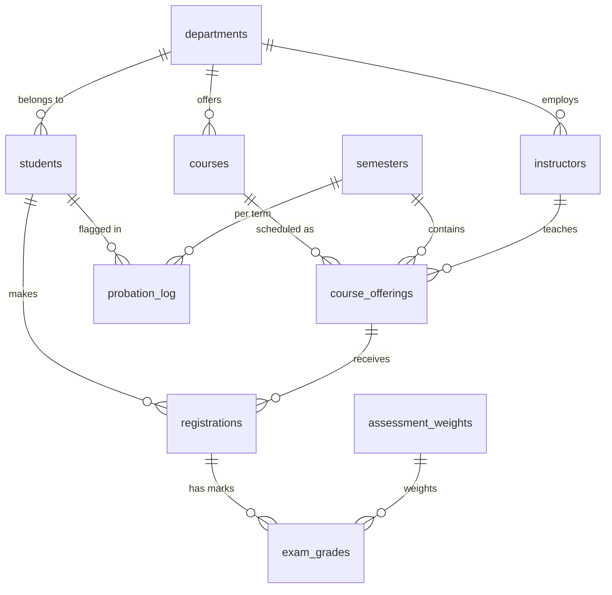

# Academic Grading & Student Performance Tracking System

A complete relational database project in **MySQL 8.0+** (also verified on MariaDB 10.11) that manages
student profiles, course registrations, semester credits and exam marks, and turns them into
credit-weighted GPAs, grade distributions, probation alerts and department honour lists.

| | |
|---|---|
| **Scale of sample data** | 5 departments, 15 instructors, 20 courses, 80 course offerings over 4 semesters, 60 students, 981 registrations, 2,787 exam marks |
| **Schema** | 12 tables, all with PK/FK/UNIQUE/CHECK constraints |
| **Logic layer** | 4 views, 2 functions, 4 procedures, 1 trigger |
| **Reports** | 31 documented analytical queries |
| **Quality gate** | 22 automated checks (`sql/05_tests.sql`), all passing |

## 1. Quick start

```bash
./run_all.sh root -p          # builds schema + data + logic, then runs the 22 tests
mysql -uroot -p academic_db < sql/04_analytics_queries.sql    # run all reports
```
Or in MySQL Workbench / any client, run the files in numeric order `01 → 05`.

| File | Purpose |
|---|---|
| `sql/01_schema.sql` | Database, tables, constraints, indexes |
| `sql/02_seed_data.sql` | Deterministic sample data (generated by `tools/generate_seed.py`, seed 2026) |
| `sql/03_views_routines.sql` | Views, functions, stored procedures, trigger |
| `sql/04_analytics_queries.sql` | Reports grouped in sections A-F |
| `sql/05_tests.sql` | Self-checking test suite (PASS/FAIL) |
| `tools/generate_seed.py` | Regenerate or resize the data set |

## 2. Data model


`grade_scale` (percentage → letter → grade points) and `academic_policy` (thresholds) are lookup tables.
**No threshold or weight is hard-coded in a query**; change a row and every report follows.

## 3. Business rules

**Course percentage** = Σ(score ÷ max × weight) ÷ Σ(weight): Assignment 20 %, Midterm 30 %, Final 50 %.

**Grade scale:** A+ ≥95 (4.0) · A 90 (4.0) · A- 85 (3.7) · B+ 80 (3.3) · B 75 (3.0) · B- 70 (2.7) ·
C+ 65 (2.3) · C 60 (2.0) · D 50 (1.0, pass) · F <50 (0.0, fail).

**GPA is credit-weighted:** `GPA = Σ(credits × grade points) ÷ Σ(credits)`. A 4-credit A matters more than a 1-credit A.
Query B4 shows how far this differs from a naïve average.

**Risk classification** (`academic_policy`):

| Level | Rule |
|---|---|
| Probation | CGPA < 2.00, **or** ≥ 8 cumulative failed credits |
| At Risk | CGPA < 2.50 |
| Watch | Semester GPA fell ≥ 1.00 versus the previous semester |

**Honours list:** students at or above the 90th percentile of CGPA inside their own department.

## 4. Where each required concept is used

| Focus area | Where |
|---|---|
| **Group functions** (`SUM, AVG, COUNT, MIN, MAX, STDDEV_POP, GROUP_CONCAT`, `GROUP BY`, `HAVING`) | B3-B5 GPA statistics, C1-C5 distributions, F1 workload; view `v_student_gpa_progress` |
| **Nested subqueries** (scalar, `IN`, `NOT IN`, correlated, subquery in `FROM`/`HAVING`) | C3 above-average failure rate, D1/D3/D4/D6 risk detection, E2 percentile without windows, E4/E6 toppers, F3/F4 |
| **Conversion functions** (`CAST, CONVERT, STR_TO_DATE, DATE_FORMAT, FORMAT, ROUND`) | A4, A1, `fn_student_code`, `sp_transcript` |
| **String functions** (`CONCAT, UPPER, LOWER, TRIM, SUBSTRING, SUBSTRING_INDEX, LEFT, LPAD, RPAD, REPEAT, LOCATE, CHAR_LENGTH`) | A1-A3 cleaning and masking, C2 text histogram, roll numbers |
| Core task: **weighted GPA** | `v_course_results → v_course_grades → v_student_gpa_progress` |
| Core task: **grade distribution** | C1-C5 |
| Core task: **probation flags** | D1-D6, `sp_refresh_probation`, `probation_log` |
| Core task: **top percentile per department** | E1-E6 (window functions *and* a pure-subquery alternative) |

## 5. Using the system

```sql
CALL sp_transcript(5);              -- full transcript: profile, courses, term-by-term GPA
CALL sp_refresh_probation(4);       -- evaluate Spring 2026 and write probation_log (idempotent)
CALL sp_register_student(12, 33);   -- validated registration (credit cap, active status)
CALL sp_record_grade(40, 'Final', 88.5);   -- upsert a mark; trigger completes the registration
SELECT fn_gpa_standing(2.3), fn_student_code(7);
```

## 6. Sample results (from the shipped data)

Honours list (≥ 90th percentile):

| Dept | Student | CGPA | Rank |
|---|---|---|---|
| CSE | Aditya Sharma | 3.93 | 1 |
| MEC | Pooja Khanna | 3.98 | 1 |
| ECE | Tanvi Khanna | 3.91 | 1 |

Latest-semester risk tiers: **10 Probation, 9 At Risk, 41 Good** (of 60).
Overall grade mix: A-band 31 %, B-band 37 %, C-band 19 %, D 10 %, F 3 %.

## 7. Design decisions

* **Views are layered** (results → grades → GPA progress → summary) so each step is testable and reusable.
* **Window functions compute running CGPA** (`SUM() OVER`) so a student's standing can be judged *as of any semester*, not just now.
* **Policy in tables, not code**: thresholds, weights and the grade scale are data.
* **Integrity at the database level**: CHECK constraints (scores ≤ max), unique registration per offering, FK everywhere, `SIGNAL`-based business rules, transactional registration with row locking (`FOR UPDATE`).
* **Idempotent jobs**: `sp_refresh_probation` can be re-run for any term without duplicating rows.
* **Intentional dirty data** (students 4 and 18 have stray whitespace/case) so the string-cleaning queries (A2) have something real to find.
* **Reproducible**: the seed generator is deterministic; change `random.seed` or the sizes to produce a different cohort.

## 8. Possible extensions

Prerequisite and capacity tables, repeat-course grade replacement policy, role-based grants
(`registrar`, `faculty`, `student` roles), a scheduled event to run `sp_refresh_probation` at term end,
and a BI dashboard (Metabase / Power BI) over the four views.
